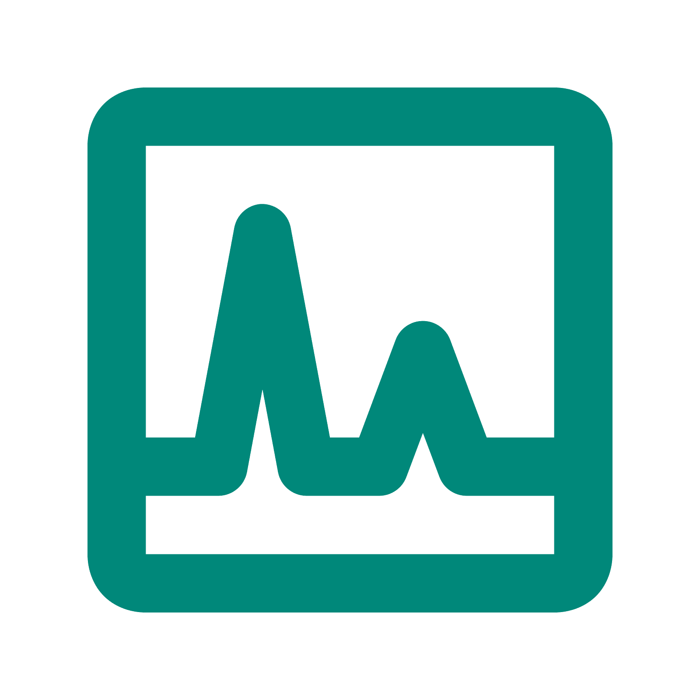

# Título do Projeto

>Inserir uma logo para o projeto

>Inserir pequena descrição do projeto

# Equipe e Formas de Contato

| Integrante | **GitHub**  | **Discord**  |
|---|---|---|
| Felipe Nascimento | `Felipemevel` | `felpszito` |
| Gustavo Jácome | `gustavofjacome` | `gutziron` |
| Wedson Gabriel | `WedsonGabriel` | `insanemonster7` |

> Descrever as formas de contato da equipe - WhatsApp, Discord, etc.

# Horário de Reuniões

> Descrever dias, horários e local das reuniões da equipe

# Documentação

1. [Link para os documentos do projeto](doc/documentacao.md)
1. [Documento de Visão](doc/visao/doc-visao.md)
1. [Protótipos de Interface com o Usuário](doc/prototipos/prototipos.md)
1. [Modelo de Casos de Uso](doc/cdu/cdu.md)
1. [Modelo de Domínio](doc/dominio/dominio.md)
1. [Modelo de Dados](doc/bd/bd.md)

# Manual da Desenvolvedor

[Orientações para os desenvolvedores do projeto](doc/guia-ds/guia.md)
